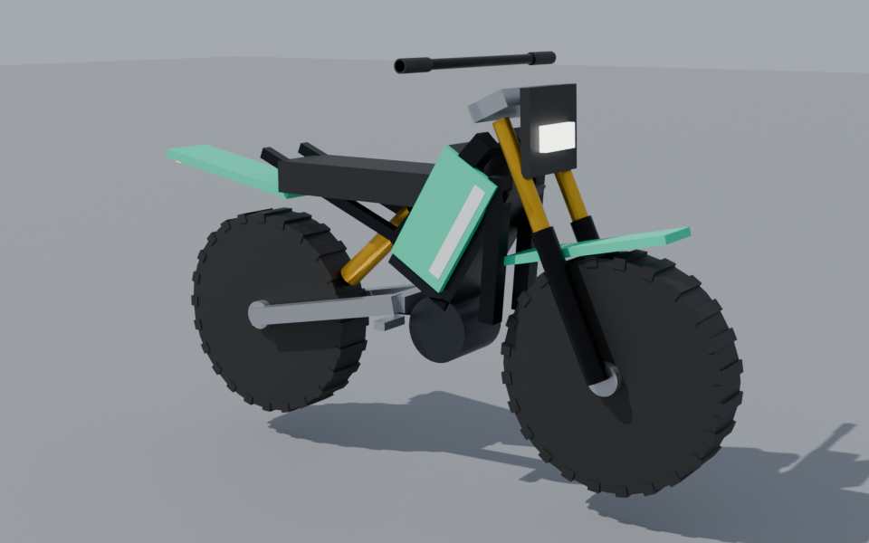
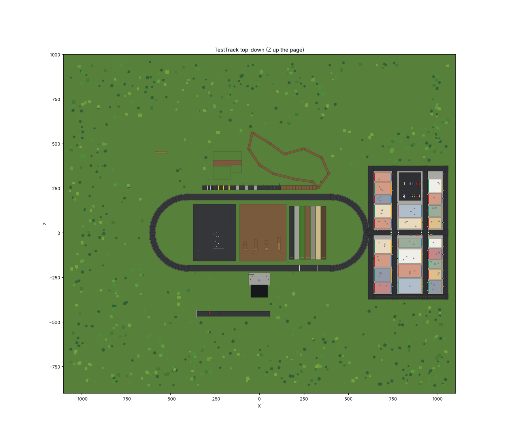
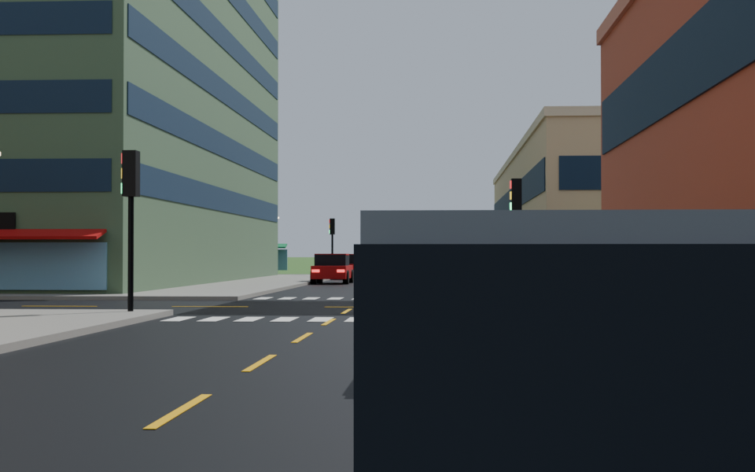
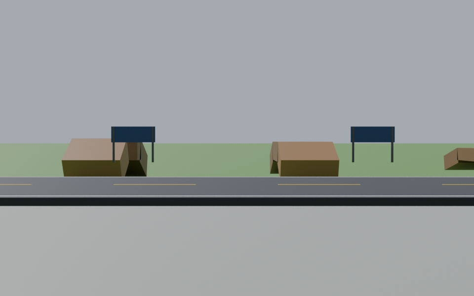

# RYDE Quality Audit (v0.2.0)

*Written 2026-10-16. Audits the game as of commit `bd84e29` (version 0.2.0).*

This report looks honestly at what exists today and lays out a plan to raise
the quality. **No game code was changed while writing it.** The only files
added are analysis tools (`tools/analysis/`, `tools/print-spec.luau`), their
results, the images in `docs/audit/`, and this report.

**Rollback point:** commit `bd84e29` on branch `claude/quirky-darwin-t7u0nt`
(also tagged `v0.2.0` locally; the hosting proxy rejected pushing the tag, but
the commit itself is on the remote branch). Any later change can be reverted to
this exact state.

---

## How to read this report

Each finding says how confident it is:

| Tag | Meaning |
|---|---|
| **[Verified]** | Measured from the project files or the built place file, or proven by an automated test. Reproducible with the commands in [Appendix A](#appendix-a--reproducing-the-evidence). |
| **[Reproduced offline]** | Reproduced with `tools/analysis/bike_sim.py`, a simulation that copies our bike's force formulas. It shows problems in **our maths**, not in Roblox itself. |
| **[Code review]** | Read directly from the source code; not run. |
| **[Needs Studio]** | Can only be confirmed by playing in Roblox Studio. I have **not** run Roblox at any point. |

The plain-language summary is at the top. The details below it are for
reference.

---

## 0. Summary in plain language

**What's actually there:** a working project structure, two bikes driven by
custom physics code, a lobby menu, a speedometer, sound, and a large map built
from simple blocks. Everything was generated by code. **Nothing is a
professionally modelled 3D asset.** The place contains **0 MeshParts** and
**0 textures**; every object is a basic Roblox block, cylinder or ball
**[Verified]**.

**The five biggest problems, in order:**

1. **Wheelies can't really be controlled.** The physics behind it is realistic
   (a balanced bike tips over about as fast as a real one), but keyboard
   players have only on/off keys. In my simulation, even a perfectly steady
   automated "rider" could not hold a wheelie. Part of the cause is a bug: the
   suspension pushes along the bike's tilted axis instead of straight up, which
   shoves the bike backwards during a wheelie.
   **[Reproduced offline]**
2. **The bike model looks like a toy.** It has 121 basic parts, 60% of which
   are tyre knobs and spokes. The wheels read as black discs, the handlebar
   floats, the side panels are flat cards, and the suspension parts don't
   actually move with the wheels. **[Verified + rendered]**
3. **The physics changes with frame rate.** On slower devices the suspension
   bounces more and bottoms out on landings. A 1.5 m drop produces 9–12× body
   weight in the suspension. **[Reproduced offline]**
4. **The map is big and empty rather than designed.** About 616 × 532 m,
   mostly grass, with randomly sized buildings and test signs everywhere.
   There's no residential street, landmarks are weak, and 61% of all parts
   are tree blobs that cast no shadows. **[Verified]**
5. **The UI uses a generic "gaming template" look.** Italic heavy fonts
   everywhere, teal glow on everything, rounded cards with outlines,
   fixed-pixel layouts that will overflow on phones, and no gamepad
   navigation. **[Verified + code review]**

**My recommendation:**

- Fix the physics first, in a small new physics test place with measurements.
- Build a new bike model in Blender. I verified I can run Blender here,
  create models and render previews for your approval. You'd only need to
  import the final file into Studio.
- Rework the camera.
- Redesign the UI with a stricter design system.
- Then rebuild a **small** map area to a high standard, rather than
  patching the big one.

Details and acceptance criteria follow.

---

## 1. Current state of each system

| System | What exists | Approach | Status |
|---|---|---|---|
| Project/tooling | Rojo project, generators, 107 automated tests, lint | Code-generated place file | Works **[Verified]** |
| Bike physics | `BikePhysics.luau` (rider's computer) | One invisible box carries all the mass; sphere-cast "wheels"; `VectorForce`/`Torque` constraints recomputed every frame | Builds and passes offline tests; v0.2 has **not been playtested** **[Needs Studio]** |
| Wheels/suspension visuals | `BikeVisuals.luau` | `Motor6D.Transform` slides/spins wheel parts; bike + rider lean drawn visually | Partly fake: fork tubes and swingarm don't follow the wheel **[Code review]** |
| Bike model | `tools/build-vehicles.luau` → 121 Parts per bike | Generated from primitives | Visually poor **[Verified]** |
| Rider | Roblox `Seat` + `IKControl` hands/feet | Character made massless, non-colliding while riding | Fit unverified **[Needs Studio]** |
| Crashes/damage | None (Milestone 4) | — | Missing |
| Camera | `RideController.luau` chase cam | Exponential position smoothing, instant aim, FOV 70→90 | Several issues **[Code review]** |
| Controls | Keyboard + gamepad (`InputController.luau`) | Digital keys; triggers analog on gamepad | No touch; gamepad camera look advertised but not implemented **[Verified]** |
| Lobby/menu | `MainMenu.luau` | 3D garage scene + overlay | Generic look; fixed pixel sizes **[Verified]** |
| HUD | `Hud.luau` | Arc speedometer made of 34 rotated frames, trick pills, controls panel | Works in theory; generic look **[Needs Studio]** |
| Sound | `SoundConfig`, `AudioController`, `BikeVisuals` | Roblox-licensed Creator Store sounds, 4 SoundGroups | 4 of 17 sounds are never played; none were listened to **[Verified]** |
| Map | `tools/build-world.luau` (4,704 parts) + `WorldService` terrain at runtime | Primitives + generated terrain | Big, sparse, inconsistent **[Verified]** |
| Lighting | Future lighting, Atmosphere, Bloom, ColorCorrection, SunRays | Project settings | Reasonable base **[Verified]** |
| Multiplayer | Server-owned spawning/mounting, client network ownership | Roblox standard | Untested with 2+ players **[Needs Studio]** |
| Saving | None (Milestone 8) | — | Missing |

### Where the assets come from

| Asset | Origin | Evidence |
|---|---|---|
| Bikes | **Generated by our code from basic Parts.** Not Blender, not imported. | `assets/Vehicles.rbxm`: 121 `Part`s each, 0 MeshParts |
| Map | **Generated by our code from basic Parts** + runtime terrain | `assets/World.rbxm`: 4,703 `Part`s + 1 SpawnLocation; 0 MeshParts, 0 Decals/Textures |
| Sounds | Roblox Creator Store: ProSoundEffects, APMOfficial, Roblox UI sounds | IDs in `SoundConfig.luau`; chosen from catalogue titles, **not listened to** |
| Fonts | Roblox built-in families (Montserrat, GothamSSm, RobotoMono) | `Theme.luau` |
| Characters | Player's own Roblox avatar | — |

---

## 2. Most important problems (ranked by impact)

| # | Problem | Area | Impact | Evidence |
|---|---|---|---|---|
| 1 | Wheelie balance not controllable with keys; suspension force tilts with the bike | Physics | Core trick unusable | [Reproduced offline] §3.1 |
| 2 | Bike model quality | Model | First impression | [Verified] §4 |
| 3 | Physics depends on frame rate; harsh landings (9–12 g) | Physics | Feels different per device; bottoming | [Reproduced offline] §3.1 |
| 4 | Camera aims instantly while position lags; large FOV swing; white-noise shake; hard cuts | Camera | Motion discomfort, twitchy feel | [Code review] §5 |
| 5 | No physics test environment or measurements in Roblox | Process | Every tuning change is a guess | — |
| 6 | Map is sprawling and undesigned | Map | Feels empty/assembled | [Verified] §7 |
| 7 | UI visual language generic; no responsive layout or gamepad navigation | UI | Looks "AI-made"; broken on phones | [Verified] §6 |
| 8 | Sound: unused events, no idle state, extreme pitch range, unverified IDs | Sound | Weak feedback | [Verified] §8 |
| 9 | Missing systems: reverse/walk-back, crashes, rider fall | Gameplay | Getting stuck, no consequences | [Code review] |

---

## 3. Bike physics

### 3.1 Findings

**How it works today [Code review]:** the bike is one invisible box (the
`Chassis`) that holds all the weight (bike + rider = 132 kg for the Voltra
Storm). Every frame, the rider's computer:

1. sphere-casts down from each wheel's mounting point to find the ground;
2. pushes the box up with a spring and damper (the suspension);
3. pushes it forward or back at the tyre contact point (motor, brakes);
4. pushes it sideways to stop sliding (tyre grip);
5. limits each tyre's total force to load × surface grip;
6. adds torques for rider lean and for keeping the bike upright.

This is a sound architecture and I recommend **keeping** it. Roblox's own
constraint wheels are less suitable for two-wheelers. The problems are in
specific formulas.

Offline results (`tools/analysis/results.txt`). The simulation copies our
formulas: forces are recomputed once per frame and held while physics steps
at 240 Hz, the same way Roblox's `PreSimulation` works.

| Test | Result | What it means |
|---|---|---|
| **S1** Settle at rest | Bounces before settling: **5 at 60 fps, 7 at 30, 8 at 20**. Peak load 1.47 → 1.84 → **2.05 g** | Lower frame rate means a bouncier bike. Cause: the damper uses the change in compression between frames, so it reacts late when frames are long. |
| **S1** with fix A | Velocity-based damper: 5/6/6 bounces, peak load 1.12/1.13/1.40 g | Much less frame-rate sensitive. |
| **S2** 1.5 m drop | Peak suspension load **9 g at 60 fps; hits the 12 g safety cap at 30 and 20 fps**, and the collision box touches the ground (clearance −0.08 studs) | Landings are harsh and bottom out on weaker devices. Real off-road bikes land a drop like this at roughly 3–5 g. |
| **S2** (hypothesis) | I suspected a damper "spike" on first contact. **Not confirmed**: the current first-contact force (2.1× weight) is lower than an accurate damper's (3.4×) | Not a bug. |
| **S3a** Hold a 25° wheelie with an automated throttle "rider" | Current code: only reaches **9.7°** then sags. With fix B: **loops over**. At 30 fps: loops over either way | Holding a wheelie is the hard part. |
| **S3b** Wheelie tap (throttle + lean for 0.4 s, then release) | Front lifts 21° (current) / 37° (fixed), then lands safely | Short wheelies work and are learnable. |
| **S4** Hold a 12° stoppie with a modulated front brake | Overshoots to −22…−26° but doesn't flip; stops in 1.7–2.2 s | Stoppies are workable. |
| **S5** Step steer at 15 and 50 km/h | Yaw rate settles on the textbook value, no wobble | I suspected sideways-grip wobble. **Not confirmed**: steering maths is fine. |

**Root causes:**

- **B. Suspension pushes along the bike's tilted axis [Code review +
  Reproduced].** In `BikePhysics.luau` the suspension force is
  `up * suspension`, where `up` is the bike's own up direction. When the
  front is lifted 30°, the rear wheel carries the whole weight, and that
  push leans backwards. Half of it (sin 30° = 0.5) shoves the bike backwards
  at about 0.5 g. That fights the motor (whose maximum is about 0.7 g), so
  wheelies sag and the bike slows down. A real tyre pushes straight out of
  the ground.
- **Wheelie balance is genuinely unstable [Calculated].** Balanced on the
  rear wheel, our bike tips with a "doubling time" of **0.26 s**. A real
  bike and rider is about **0.23 s**. So the physics is realistic. But a real
  rider balances with a progressive throttle, the rear brake and their body.
  A keyboard player has two on/off keys (W and Shift). Realistic physics with
  digital controls is unplayable without help.
- **A. Damper uses frame-to-frame change [Code review + Reproduced].** This
  makes behaviour depend on frame rate (see S1).
- **Landing harshness [Reproduced].** Short travel (0.20–0.22 m), damping
  ratio 0.5, and a linear spring with a sudden very stiff bump-stop (12×
  spring rate).

**Other issues [Code review]:**

- **No reverse.** With your nose against a wall you can't back out; R
  resets the bike in place. Real e-bikes have a slow reverse or you push
  them.
- **Each tyre uses a single grip value for both directions.** Front uses
  `lateralGrip`, rear uses `longitudinalGrip`. A small error.
- **The collision box is 1.5 studs wide** but the handlebars are 2.8 studs
  wide and the rider doesn't collide. Bars and rider will pass through walls,
  poles and other bikes **[Needs Studio to judge how noticeable]**.
- **The physics body never leans; only the visuals do.** This was a
  deliberate stability choice. In tight spaces the drawn bike can lean
  through a wall.
- **No crash detection, rider fall or damage yet** (Milestone 4). Looping a
  wheelie just leaves the bike upside down.
- **A riderless bike falls onto its collision box, then "pops" upright**
  when the server parks it after 1.5 s **[Code review]**. It will look abrupt.
- **Sphere-casts ignore anything the sphere starts inside.** If a wheel ends
  up inside geometry (a very hard landing on a kerb edge), that wheel loses
  contact for a frame. Not observed in the simulation; **[Needs Studio]**.

### 3.2 Recommendations

| ID | Change | Why | Measured by |
|---|---|---|---|
| PH1 | Apply the suspension force along the **ground normal**, not the bike's axis | Removes the backwards shove in wheelies and on slopes | S3a; wheelie acceleration |
| PH2 | **Velocity-based damper** (hub velocity along the suspension axis) | Frame-rate independence | S1 at 20/30/60 fps |
| PH3 | **Progressive suspension**: rising spring rate in the last 30% of travel, damping ratio ~0.65, softer bump-stop; possibly a little more travel | Landings at 3–5 g, no bottoming | S2 |
| PH4 | **Wheelie control model**: progressive throttle (keyboard W ramps up over ~0.4 s and can be "feathered"), rear brake (S) instantly drops the front, and an optional **balance assist** (Off / Light / Standard, adding a gentle pull toward the balance angle only while wheeling) | Makes the signature trick playable without faking it | PhysicsLab wheelie timer, playtests |
| PH5 | Slow **reverse / walk-back** below 3 km/h (hold S when stopped) | Never stuck | Manual test |
| PH6 | Grip per direction per tyre (use both config values) | Correctness | Unit test |
| PH7 | Crash detection + rider fall (Milestone 4, after PH1–PH5) | Consequences, recovery | Milestone 4 criteria |
| PH8 | Move `BikePhysics` to `shared` so the **server can also run it** with scripted input | Enables automated physics tests inside real Roblox servers (see §3.3) | — |

Each change gets an offline test where possible and a PhysicsLab
measurement. No "magic number" tweaks without a measurement before and after.

### 3.3 Controlled physics test environment ("PhysicsLab")

A **separate, small place file** (`build/PhysicsLab.rbxl`) that shares the
same game code, so measurements aren't affected by the big map:

- **Flat 400 × 400 stud asphalt pad** with **timing gates** (invisible parts)
  at 0, 50, 100 and 200 m. They log speed and time.
- **Braking strip**: brake at the line; the script measures stopping
  distance.
- **Bump rig**: kerbs at 0.15/0.3/0.5 m, a rumble strip and whoops.
- **Drop rig**: drops of 0.5, 1.0, 1.5 and 2.5 m onto flat ground and onto a
  landing ramp. The script measures peak suspension load, bottoming and
  bounce.
- **Wheelie lane**: an on-screen timer for "front wheel up and pitch between
  15° and 45°".
- **Surface strips** with known grip.
- **Autopilot scenarios**: scripted input sequences (for example "full
  throttle 5 s, then full brake") that run identically every time and print
  a CSV line per test to the Output window. You run them and paste the
  Output to me, which gives me real Roblox numbers.
- **Optional: fully automated runs.** Roblox Open Cloud can run Luau
  scripts in real Roblox servers. This needs your experience's universe and
  place IDs and an API key with that permission, which you'd create on the
  Creator Hub. With PH8 the server could drive bikes with scripted input and
  I could run these tests myself. Not required, but it would remove you from
  the test loop for physics numbers.

### 3.4 Physics acceptance criteria

Measured in PhysicsLab at **60 fps and at 30 fps** (Studio can limit the frame rate):

| Area | Criterion |
|---|---|
| Acceleration | Voltra 0–50 km/h in 3.0–4.0 s; Kestrel 10–20% quicker |
| Top speed | Voltra 72–75 km/h on flat asphalt, never above 77 |
| Braking (S) | 50 → 0 km/h in 12–16 m without lifting the rear |
| Front brake | Stoppie possible from ≥ 25 km/h; no flip if released within 0.5 s |
| Rest | ≤ 2 visible bounces after spawning or a small drop; no creeping on flat ground |
| Landing 1.5 m flat | Peak suspension load ≤ 5 g; chassis box never touches; one rebound ≤ 10% of drop height |
| Frame-rate independence | Each metric above within ±10% between 60 and 30 fps |
| Wheelie | With balance assist "Standard": a new player holds 15–45° for ≥ 5 s after ≤ 10 min practice (playtest with 2+ people); with assist "Off": possible but hard (skilled players) |
| Steering | No oscillation after a step steer; lean ≤ 45°; U-turn radius at walking speed ≤ 3 m |
| Kerbs | 0.15 m kerb taken at ≥ 10 km/h without losing control; 0.5 m kerb stops the bike (needs a hop later) |
| Stuck | Never stuck against a wall (reverse works) |
| Performance | `BikePhysics.step` ≤ 0.3 ms/frame in the MicroProfiler on a mid PC |
| Multiplayer | With Studio's network simulation at 150 ms ping, other riders' bikes move without visible pops > 1 stud |

---

## 4. Bike model

### 4.1 What's wrong (from the actual model)

`docs/audit/bike_current_render.png` shows the generated Voltra Storm,
rebuilt part by part in Blender and rendered. It uses approximate materials,
not Roblox's renderer.



**Visual problems [Verified + rendered]:**

| Component | Problem |
|---|---|
| Wheels / tyres | Flat-sided cylinders read as **solid black discs**. The 24 block "knobs" per tyre look like gear teeth. Rims are dark and the spokes are 0.04-stud slivers, so the wheel has no visible structure. There's no tyre profile (round shoulder). |
| Silhouette | No continuous line from bars over the seat to the tail, which is the defining shape of a light electric dirt bike. The body is a few separate boxes. |
| Side panels ("shrouds") | Flat rectangular cards stuck on the sides. |
| Handlebar | Floats above a disconnected grey block. No bar clamp, risers or levers. |
| Front fender | A flat plank instead of a curved fender above the tyre. |
| Frame | Thin square bars; two frame bars poke out behind the seat. |
| Brakes / drivetrain | Brake discs hidden inside the wheels, no calipers; drive belt is a thin bar; no sprockets. |
| Materials | Flat `SmoothPlastic`/`Metal` colours; no texture, wear or decals. |
| Efficiency | **121 parts, of which 72 (60%) are tyre knobs and spokes** that add part count but little visual value. |

**Functional problems [Code review]:**

- **Rear suspension:** the wheel slides up and down but the **swingarm
  doesn't pivot**. With suspension movement, the wheel separates from the
  swingarm visually.
- **Front suspension:** the wheel slides along the fork, but the fork's
  lower tubes **don't telescope**, so the wheel moves away from the fork legs.
- **Wheels:** spinning and steering work (rotation via `Motor6D.Transform`)
  **[Needs Studio]** to see.
- **Rider fit:** the seat is at real-world height (0.85 m = 3.04 studs). The
  default R15 avatar is roughly 5 studs tall, about 1.4 m at Roblox's scale,
  so the bike may look oversized next to the rider, and IK has to stretch the
  arms and legs. **[Needs Studio]** — a screenshot of a rider on the bike
  decides this.

### 4.2 Options

| Option | Quality ceiling | Effort | Risks |
|---|---|---|---|
| A. Improve the current part-built model | Low–medium (no curves, no real shapes) | Small | Still looks "blocky" |
| B. Import a free Creator Store model | Varies | Small | See the research below: none suitable |
| C. Buy/licence a model from an external marketplace | Medium–high | Medium + cost | Licence terms, real-brand look, heavy meshes need cleanup |
| **D. Build a new, original model in Blender** | **High** (within stylised realism) | Medium | Needs one manual import step in Studio |

**Creator Store research [Verified, metadata only].** I queried the Creator
Store catalogue for "electric dirt bike", "dirt bike", "motocross bike",
"electric motorcycle" and "pit bike" (about 45 models). I could only read
metadata, not see the models:

- Most are **replicas of real brands** (Surron, KTM, Honda CRF, Husqvarna,
  Yamaha, Stark Varg, Razor). That's a trademark risk for a game that may be
  monetised.
- **Most contain scripts.** Roblox's own guidance warns that free assets can
  hide malicious code that loads more code (`require(assetId)`,
  `loadstring`), and recommends disabling their scripts.
- **Very heavy.** Many are 100k–660k triangles; Roblox limits each mesh to
  20,000 (docs: *art/modeling/specifications*).
- Several look like **re-uploads of other creators' work** (identical
  triangle counts under different spammy names).
- Votes are low (best: 43 up / 7 down).

None passes all checks without inspection in Studio, and the most-voted ones
fail on brand or scripts. **I don't recommend importing any of them.**

**Blender pipeline [Verified].** I installed Blender 5.2.2 as a Python module
in this environment, built a test object, rendered it with Cycles (2 s) and
exported FBX, the format Studio's 3D Importer takes. So I can:

1. model an original bike in Blender with code (frame, swingarm, fork,
   wheels, plastics, seat, bars, brakes, drivetrain);
2. render previews from several angles **for your approval before anything
   enters the game**;
3. export FBX. **You** import it with **Studio → 3D Importer**, which takes
   about 2 minutes and I'll write step-by-step instructions. (Alternatively,
   with an Open Cloud API key that has asset-upload permission, I could
   upload it myself.)

Honest limit: I model with code, not by hand-sculpting. Expect clean,
well-proportioned, stylised-realistic hard-surface shapes, not
photo-scanned detail. The previews show the real result before you commit.

### 4.3 Recommendation

**Option D: a new original model in Blender.** Option A stays as a quick
stop-gap only if you want something better immediately. Wait for your
approval before replacing anything.

Model specification:

- Separate meshes for every part that moves: frame/body, **swingarm (pivots
  on its bolt)**, **fork lowers (telescope)**, fork uppers + clamps + bars
  (steer), each wheel (spin), shock. That makes the suspension genuinely
  visible.
- Recolourable panels (keep the `Paint` = Primary/Secondary/Accent
  convention) for customisation and future upgrades/tycoon parts.
- **≤ 12,000 triangles for the whole bike, ≤ 20,000 per mesh** (Roblox
  limit). Two wheels share one mesh, so Roblox draws them in a single batch
  (docs: *performance-optimization/improve*, "instancing").
- Roblox materials + colours first; textures (SurfaceAppearance) later if
  needed.
- Keep the existing "model contract" (Chassis, LeanRoot, SteerRoot, joints,
  Seat, grip/peg attachments) so the physics and visuals code keeps working.

### 4.4 Bike model acceptance criteria

- Approved by you from rendered previews (front ¾, side, rear ¾, top) **before** import.
- Proportions within ±5% of the config: wheelbase 1.26 m, wheel Ø 0.66 m,
  seat 0.85 m (or a documented scale adjustment after the rider-fit check).
- ≤ 12k triangles total, ≤ 20k per mesh, ≤ 25 MeshParts.
- In Studio: the swingarm visibly pivots with rear travel, the fork lowers
  telescope, the wheels spin and steer, with no gaps or intersections at
  full compression or full extension.
- Rider's hands within 0.1 studs of the grips and feet on the pegs while
  riding (screenshot).
- Reads clearly as an electric dirt bike at 30 m (silhouette test in-game).
- No real brand names, logos or protected designs.

---

## 5. Camera

### 5.1 Findings [Code review]

`RideController.luau`: the camera sits 12 studs behind and about 2 studs
above a point 2.5 studs over the bike's centre (about 9 studs ≈ 2.5 m above
the road). It looks at a point 3 studs ahead.

| Issue | Detail | Effect |
|---|---|---|
| Position smoothed, aim not | Position follows with exponential smoothing; the aim point is the current bike position + heading, with no smoothing | The view swings and snaps in quick direction changes; can feel twitchy |
| Large FOV swing | 70° → **90°** at top speed | A strong speed effect, but known to cause discomfort for some players |
| Shake | Random new offset **every frame** on landing (white noise) | Reads as jitter, not impact |
| Wall avoidance | Camera snaps to the hit point instantly; no recovery smoothing | Popping near buildings |
| Mouse look | Sets `MouseBehavior` every frame, which Roblox's own camera scripts may override | Mouse look may not work reliably **[Needs Studio]** |
| Gamepad look | **Not implemented**, although the Controls screen lists "Right stick" | Bug **[Verified]** |
| Touch | Not implemented | No mobile play |
| Dismount / crash | Hard cut back to Roblox's default camera; no crash view | Jarring |
| Settings | Only "chase camera on/off" | No distance/FOV/motion options |

### 5.2 Recommended camera style

A **stable "chase" camera that follows the road, not every twitch of the bike:**

- **Spring-damper follow** for position *and* aim (critically damped, no
  overshoot). The camera trails slightly more in yaw than in position, so
  turns feel smooth.
- **Horizon always level**; the bike leans, the camera doesn't (the main
  comfort rule for motion).
- **Distance and height grow slightly with speed** (about 10 → 14 studs) to
  show more road ahead. **FOV +0 to +8° max**, with a "Reduce motion"
  setting that disables FOV change and shake.
- **Look-ahead**: aim shifts toward where the bike is heading in turns.
- **Wheelies and jumps**: the camera follows the bike's *path*, not its
  pitch, so wheelies are visible without the view tilting. Vertical motion is
  damped more on landings.
- **Impact shake**: one short decaying oscillation (not random noise),
  scaled by landing force and capped.
- **Collision**: a sphere-cast from bike to camera; pull in quickly, recover
  slowly.
- **States**: riding → crash (orbit the rider/bike for 2 s) → recover;
  dismount blends to the on-foot camera over about 0.4 s.
- **Inputs**: mouse drag (PC), right stick (console) and touch drag
  (mobile) orbit, then auto-return behind the bike after about 1.5 s.
- **Settings**: distance (Near/Normal/Far), FOV (60–80), Reduce motion,
  Invert Y.

### 5.3 Camera acceptance criteria

- At 60 km/h on the straight, the bike fills **8–15% of the screen height**
  and the road is visible at least 60 m ahead (screenshot check).
- No visible jitter or snapping in a slalom at 30 km/h (video check).
- FOV change ≤ 8°; with Reduce motion, 0° and no shake.
- Camera never shows the inside of a wall or terrain in the town (5-minute ride).
- Works with mouse, gamepad right stick and touch drag; auto-returns behind the bike.
- Smooth transitions on dismount and crash (no hard cuts).
- Testers report no discomfort in 10-minute sessions (ask 2+ people).

---

## 6. UI redesign

### 6.1 Why it looks generic [Verified from code]

- **One loud style everywhere:** Montserrat Heavy Italic for the logo (128
  px), the menu (48 px) and the speed number. Italic display type stops
  meaning anything when everything uses it.
- **Accent colour overused:** teal is used for buttons, bars, outlines,
  underlines, the arc, neon in the garage and stats. When everything is
  highlighted, nothing is.
- **Template patterns:** rounded 14 px cards with thin white outlines, a big
  gradient shade, pill buttons, "glow" outlines on trick pills, and an emoji
  lock (🔒) in the garage list.
- **Fixed pixel layout:** panels are fixed sizes (440 × 560, 380 × 230, 72 px
  margins). The menu creates a `UIScale` but **never sets it**. On a phone in
  landscape (about 375 px tall), the 560 px Settings panel can't fit.
- **No safe areas:** `ScreenGui.ScreenInsets` is never set (phone notches).
- **No gamepad navigation:** nothing is selectable with a controller.
- **Speedometer:** 34 separately rotated frames form a segmented arc. It is
  busy and can look jagged at small sizes. The speed number uses a font
  whose digits may have different widths, so it can wobble as the number
  changes **[Needs Studio]**.

### 6.2 Design direction: "Paddock"

A restrained, technical look inspired by **real motorcycle instruments and
race-paddock signage**: information first, decoration last.

**Principles** (the same ones Roblox's UI/UX guide stresses: hierarchy,
attention, visual language, consistency, and reserved zones / thumb zones
on mobile):

1. **One signal colour, used only for "live" things.** Accent = current
   selection, throttle, and active state. Everything else is neutral.
   Red is reserved for braking, damage and warnings.
2. **Typography does the work.** One neutral sans family (Roblox's
   **Builder Sans** or Gotham) in 3–4 weights. A strict scale: 12 / 14 / 18 /
   24 / 40 / 72. Upright, not italic. Small UPPERCASE labels with letter
   spacing for categories; large tabular numerals for speed and prices.
3. **8-point spacing grid.** Every margin and gap is a multiple of 8 px
   (then scaled per device).
4. **Flat surfaces, few shapes.** Near-black panels at about 92% opacity,
   **2–4 px corners**, 1 px hairline dividers. No glow, gradient or
   drop-shadow effects; no emoji.
5. **Data looks like a spec sheet.** Garage stats are real numbers with
   units and comparison deltas (+8 km/h) rather than coloured bars alone.
6. **Motion is short and functional:** 120–180 ms ease-out, no bounces.
7. **Context over clutter:** while riding, show speed plus what changed
   (e.g. "Wheelie 3.2 s"); show key hints only on the first ride or on
   request.
8. **One layout system for every device:** Scale-based sizes with
   `UISizeConstraint` / `UIAspectRatioConstraint`, `ScreenInsets` =
   `CoreUISafeInsets`, larger touch targets (≥ 44 px) on mobile, and
   controller selection everywhere.

**Palette (proposal):**

| Name | Use |
|---|---|
| Asphalt `#0E1013` | Base panels |
| Graphite `#1A1D22` | Raised surfaces |
| Hairline `#FFFFFF` at 8% | Dividers |
| Bone `#ECEAE4` | Primary text |
| Concrete `#8C919A` | Secondary text |
| Signal (one hue; keep RYDE teal or switch to a volt-yellow — your choice) | Live / selected only |
| Amber `#FFB020` / Red `#FF4048` | Warning / brake, damage |

**What to learn from professional games (principles, not copying).** I
can't view current screenshots of other games from this environment. This
list draws on well-known qualities of these games, and **you should play
them to compare**:

- *Gran Turismo 7*: car menus treated like a museum or spec sheet, with lots
  of space and calm typography.
- *Forza Horizon* series: big flat tiles, very clear focus states, fast
  controller navigation.
- *Trackmania*: a tiny, highly legible speed HUD that stays out of the way.
- *Riders Republic* and real e-bike LCD displays: bike-specific readouts
  (speed, battery, mode) with tabular numbers and few icons.
- Popular Roblox driving games: watch how they handle **mobile** controls
  and garage flows on phones. Play two or three on a phone and note what is
  easy or annoying.

### 6.3 Screens to redesign

| Screen | Plan |
|---|---|
| **Riding HUD** | Bottom-centre cluster: large tabular speed, unit, a thin throttle/brake line, later battery and damage. Trick feedback as short text above it that fades. Contextual hints instead of a permanent controls panel. Mobile: controls in the thumb zones; HUD moved clear of them. |
| **Lobby / main menu** | Keep the 3D garage scene but **reframe the camera** (§7) and reduce neon. A left column of plain menu items with a clear selected state. Profile chip simplified. |
| **Garage / vehicle select** | Left rail list → centre 3D bike → right spec sheet (top speed, power, weight, 0–50, with deltas vs current bike). Owned/locked/price states use text and icons consistently. |
| **Customisation** (new, design only first) | Tabs: Paint, Parts, Rider. Swatches, live 3D preview, price and "cosmetic vs performance" clearly separated. Works with tycoon-style upgrades later. |
| **Settings** | Grouped list; controller-navigable; camera options from §5. |
| **Mobile controls** (new) | Throttle/brake on the right, steer slider or stick on the left, lean buttons, all in reserved/thumb zones (docs: *ui/position-and-size*, "Cross-platform factors"). |

Process: a **static mock-up** of the HUD and garage screen comes first, as an
image I render for your approval. Then the code. The existing menu logic
(navigation, settings, spawn) is kept; only the presentation layer changes.

### 6.4 UI acceptance criteria

- Approved mock-ups before implementation.
- Layouts verified in Studio's device emulator at **1920×1080, 1366×768,
  1024×768 (tablet), 812×375 (phone landscape)** and a console 10-ft view:
  nothing clipped, nothing under the notch or Roblox's buttons.
- Every menu fully usable with a **gamepad only** and with **touch only**.
- Minimum text 12 px at 1080p (never below Roblox's recommended minimum of
  9 when scaled); contrast ≥ 4.5:1 for text.
- While riding, the HUD covers ≤ 12% of the screen (excluding mobile
  controls).
- One accent colour; no gradients/glows; corner radius ≤ 4 px (checked by
  code review).

---

## 7. Map and environment

### 7.1 Findings [Verified unless marked]

Measured from `assets/World.rbxm` (4,704 parts) and `WorldService.luau`:

| Area | Finding |
|---|---|
| Size vs content | Terrain spans 2,200 × 1,900 studs (**616 × 532 m**). Built content clusters in the middle and east; most of the area is open grass with scattered trees. |
| Trees | **2,858 parts (61% of the map) are trees**, mostly leaf balls. **0 of about 2,200 canopy parts cast shadows** (decorative parts were set to no-shadow), which makes the vegetation look flat. |
| Streets | Town streets are **30 studs = 8.4 m** wide with parked cars inside that width. A typical US two-lane street with parking is about 10–12 m. No turn lanes, stop lines (except crossings on one street), corner radii or driveway cuts. Intersections are overlapping slabs separated by 0.002-stud height offsets to avoid flicker, which may still shimmer at distance **[Needs Studio]**. |
| Sidewalks | Each whole block is one raised slab. No separate sidewalk, planting strip or kerb ramps. |
| Buildings | Each is **one box** with random height (2–7 floors), one of 8 random colours and random brick/concrete. Windows are continuous glass bands, so they read as office ribbon windows, not a Main Street. Shopfronts only on the short ends; no doors, frames, cornices or back alleys. The street wall is incoherent. |
| Residential | **None.** The brief asks for American neighbourhoods. |
| Countryside | Terrain hills are random spheres; the dirt trail is a **flat strip of parts**; the hill is tilted slabs with vertical cliff sides; jumps are wooden planks. |
| Test zones | Blue sign boards and the test oval sit in the middle of the world, which breaks immersion. |
| Landmarks | Only the garage. Few reasons to explore. |
| Terrain | Generated when the server starts, so **you can't see or edit it in Studio's edit mode**. That blocks hand-polish (painting, smoothing, blending around roads). Roads sit 0.1 studs above terrain; terrain may poke through at slab edges **[Needs Studio]**. |
| Lighting | Future lighting, atmosphere, bloom and colour grading are set; one fixed time of day (15:12). A reasonable base. |
| Performance | 4,704 parts, 10 lights, 88 SurfaceGuis, 0 MeshParts, `StreamingEnabled` off. Fine on PC; not tested on mobile. Repeated objects (trees, lamps, cars) are many parts each instead of **one instanced mesh**, so Roblox can't batch-draw them as efficiently (docs: *performance-optimization/improve*, "instancing"). |



*(Top-down plan generated from the map file. Terrain isn't shown.)*



*Volt Avenue at rider eye level, rendered in Blender from the map file
(approximate materials; no Roblox lighting, signs' text or terrain). The
continuous window bands and plain boxes read as generic office blocks, not
a US main street. The dark block on the right is a parked car seen close up.*



*The view from the spawn plaza toward the oval: the test infrastructure (blue
sign boards, box-like plank ramps) dominates what a new player sees first.*

### 7.2 Art direction proposal: "Sunbelt Stylised"

A **stylised-realistic suburban/edge-of-town US setting** (think a small
Southwestern or Midwestern town edge in late afternoon). Clean shapes, real
proportions, restrained colours, not photorealism.

**Scale standard (1 stud = 0.28 m):**

| Element | Real | Studs |
|---|---|---|
| Traffic lane | 3.3–3.6 m | 12–13 |
| Residential street (kerb to kerb, 2 lanes + 1 parking side) | ~10 m | 36 |
| Sidewalk | 1.5–2 m (+ 1–2 m planting strip) | 6–7 (+ 4–7) |
| Kerb height | 15 cm | 0.55 |
| Storey height (shop / house) | 4.0 / 3.0 m | 14 / 11 |
| Street light | 8–9 m tall, every 30–40 m | 30, every 110–140 |
| Single-family lot | ~18 × 35 m | 64 × 125 |

**Reference board (what to take from each).** No images are included,
because I can't gather licensed reference photos from here. A practical step
for you: collect 10–20 photos per row (Google Street View screenshots are
fine for **private reference**, not for use in the game).

| Reference | Take from it |
|---|---|
| Small-town US "Main Street" (2–3 storey brick commercial blocks) | Consistent cornice line, ground-floor glass + awnings, upper windows in rows, signs above doors |
| 1960s–90s US suburb (single-storey ranch houses, driveways, lawns, mailboxes) | Repetition with small variation; driveways as kerb cuts; garages; fences |
| Strip mall + parking lot | Wide parking, light poles, monument sign: a natural stunt and parking playground |
| Edge-of-town industrial/self-storage | Long flat walls, loading docks, ramps: natural riding spots |
| Dry-creek / wash trail with culverts | Elevation and natural jumps in a believable place |
| Skate-park / pump-track | Purpose-built stunt area that fits the setting |
| Golden-hour lighting in desert towns | Warm low sun, long shadows, hazy distance |

### 7.3 Recommended approach

**Build one compact, polished "vertical slice" (about 700 × 700 studs ≈
200 × 200 m)** instead of extending the big map:

1. **Layout first (greybox)** following the scale standard:
   - one Main Street block;
   - one residential street with houses and driveways;
   - a strip mall with parking;
   - an edge-of-town wash/trail with real elevation and 2–3 natural jumps;
   - one small skate/pump park;
   - a **loop route** connecting them, plus a few shortcuts.
   You approve a top-down plan and a few greybox views before any detailing.
2. **Modular kit in Blender**: about 15–25 reusable meshes (road/kerb pieces
   with corner radii, sidewalk tiles, 3 house shells, 2 storefront modules,
   lamp, traffic signal with mast arm, hydrant, mailbox, fence, 3 tree types,
   bush, rocks). Reused everywhere, so Roblox can batch-draw them.
3. **Hand-editable terrain.** Bake the terrain into the place file once
   (generate it in Studio with a command, then save) so it can be painted
   and blended in Studio. Exact steps in the implementation phase.
4. **Lighting pass**: golden-hour preset, shadows on vegetation,
   atmosphere tuned to the kit's colours.
5. **The test track moves into PhysicsLab**; the main game world has no
   test signs.
6. **Performance**: `StreamingEnabled` on with streaming-friendly models;
   part budget of about 6,000 instances in the slice; check on a phone.

**Manual work needed:** importing the Blender kit (Studio 3D Importer);
baking/painting terrain in Studio; a phone test.

### 7.4 Map acceptance criteria

- You approve the top-down plan and greybox screenshots before detailing.
- Every street matches the scale table (code-checked from the generator data).
- Riding loop: a continuous 2–3 minute route at mixed speeds through all
  areas, with at least 6 natural stunt spots and 3 visible landmarks.
- No floating, z-fighting or terrain poking through roads (Studio screenshots
  at 5 locations).
- ≥ 50 fps on a mid-range phone and ≥ 60 fps on a mid PC while riding through
  the town (Studio's MicroProfiler/stats plus one real phone test).
- No visible test signage in the main world.

---

## 8. Sound and game feel

### 8.1 Findings

| Finding | Evidence |
|---|---|
| **4 of 17 sounds are never played:** `BrakeSqueal`, `Impact`, `BodyFall`, `RideMusic` | [Verified] grep of `src/` |
| No IDs have been listened to; quality and loopability unknown | [Verified] chosen from catalogue titles |
| Motor: one loop pitched from 0.55× to about 1.9×. Extreme pitch shifting sounds artificial ("chipmunk") at the top | [Code review] `BikeVisuals.luau` |
| No idle/standstill hum, no throttle on/off transient, no regen whine | [Code review] |
| Suspension compression/rebound sounds missing (only landings) | [Code review] |
| Ambience is global 2D: birds and traffic everywhere, even in town or inside the garage | [Code review] `AudioController.luau` |
| Remote players' bikes estimate throttle from acceleration (OK); their landings play only within 160 studs | [Code review] |
| UI sounds on every hover may become tiring | [Needs Studio] |

### 8.2 Recommendations

1. **Listen first.** You play each sound in Studio (I'll provide a small
   "sound board" test screen) and mark keep/replace. Or, if you can share
   them, I compare alternatives.
2. **Layered motor:** a low hum layer and a high whine layer, crossfaded by
   speed, with each layer's pitch range kept within about ±40%. Add a throttle
   "load" layer that responds instantly to input, and a soft regen whine when
   coasting.
3. **Event-driven one-shots** wired to real physics events: suspension
   bottoming, kerb hits (sudden compression), landings scaled by impact,
   skid start/stop, brake squeal at low speed with hard braking, chassis
   impacts and rider falls (Milestone 4).
4. **Zoned ambience**: town (traffic, distant voices), countryside (birds,
   wind), garage (room tone). Crossfade by area.
5. **Mix rules:** the player's own bike always slightly louder than others';
   UI hover sounds quieter or removed.

### 8.3 Sound acceptance criteria

- Every sound listened to and approved (sound-board checklist).
- No sound outside a 0.6–1.6 pitch range during normal riding.
- Each listed physics event produces its sound within one frame, and no
  sound plays without its event (playtest checklist).
- Ambience changes when moving between town, country and garage.

---

## 9. Keeping the door open for a tycoon later

Nothing here blocks a tycoon direction. To keep it open:

- Keep **vehicles as data** (configs) plus **models with a fixed contract**.
  Upgrades become config modifiers (e.g. motor +10%).
- Treat the **garage as a separate concept** from the showroom menu, so a
  player-owned garage or plot can be added later.
- Design the save data (Milestone 8) with ownership, upgrades and garage
  slots from the start, versioned.
- Design the customisation UI to show **cosmetic vs performance** parts
  separately (this also supports tycoon progression).

---

## 10. Dependencies and risks

| Risk | Effect | Mitigation |
|---|---|---|
| I can't run Roblox | Physics, camera and visuals are confirmed only by your playtests | PhysicsLab prints numbers you paste back; optional Open Cloud automated tests; offline simulations for the maths |
| Importing models needs Studio | Blender models need one manual import step | Step-by-step guide; or an Open Cloud key with upload permission |
| Code-built models have a quality ceiling | May not match hand-sculpted assets | Rendered previews before approval; later, a hired 3D artist could refine the same files |
| "Feel" is subjective | Endless tweaking | Fixed acceptance criteria plus short playtests with 2+ people |
| Free/third-party assets | Malicious scripts, IP problems, heavy meshes | Original assets only, unless a specific asset passes licence, script and triangle checks |
| Sound IDs unverified | Possibly bad or non-looping sounds | Sound-board review |
| Mobile performance unknown | Lag on phones | Part budget, instanced meshes, streaming, a real phone test |
| Large refactors break working features | Regressions | Rollback point `bd84e29`; automated tests kept green; one system per change |

**Order dependencies:** physics fixes (PH1–PH5) → camera (depends on
physics behaviour) → crashes (Milestone 4). The bike model can be built in
parallel but its moving parts must match the physics geometry. UI can be
done in parallel. The map slice comes after the art direction and kit are
approved.

---

## 11. Prioritised implementation plan

Each phase ends with something you can test, and **I stop for your approval
between phases.**

| Phase | What | Who does what | Output |
|---|---|---|---|
| **1. PhysicsLab** | Separate test place, timing gates, drop/bump/brake rigs, autopilot scenarios, CSV logging. No gameplay changes. | Me: build. You: run it once and paste the Output. | First **real Roblox measurements** of the current physics |
| **2. Physics fixes** | PH1 normal-direction suspension, PH2 velocity damper, PH3 progressive suspension, PH4 wheelie control + assist, PH5 reverse, PH6 grip fix | Me: implement + offline tests. You: run PhysicsLab + a 10-minute ride. | Physics meeting §3.4 |
| **3. Camera** | Spring camera, look-ahead, settings, gamepad/touch orbit, dismount transitions | Me + your playtest | Camera meeting §5.3 |
| **4. Bike model v2** (parallel with 2–3) | Blender model → previews → **your approval** → FBX → your Studio import → I wire it up | Me: model and renders. You: approve, import. | Bike meeting §4.4 |
| **5. UI v2** (parallel) | Design system + HUD + garage mock-ups → **approval** → implementation, responsive + gamepad + touch controls | Me + your device checks | UI meeting §6.4 |
| **6. Map vertical slice** | Plan → greybox → **approval** → Blender kit → detail → lighting → terrain bake/paint | Me: plan, greybox, kit. You: approve, import, terrain steps in Studio. | Slice meeting §7.4 |
| **7. Sound pass** | Sound board, layered motor, event sounds, zoned ambience | You: listen/approve. Me: implement. | Sound meeting §8.3 |
| **8. Milestone 4: crashes & damage** | Collision evaluation, rider fall, recovery, damage states | — | Per the original brief |

**Recommended first step:** Phase 1 (PhysicsLab). It's small, changes no
gameplay, and gives us real numbers to judge every later change.

### What I need from you to start

1. Approve (or change) the plan and phase order.
2. Choose the signal colour direction: keep RYDE teal, or switch to volt-yellow.
3. Optional: a screenshot of your character sitting on the current bike (the
   rider-fit check), and any notes from riding v0.2.0. Even "it flips
   immediately" is useful.
4. Optional: whether you want automated physics tests via Open Cloud (I'll
   explain how to create the key safely).

---

## Appendix A — Reproducing the evidence

```sh
./tools/build.sh                                  # build + 107 tests
lune run tools/print-spec VoltraStorm             # derived physics numbers -> JSON
python3 tools/analysis/bike_sim.py                # offline physics scenarios -> tools/analysis/results.txt
# Rendering the part-built bike in Blender (needs the 'bpy' Python package, Python 3.13):
#   1. export parts to JSON (see tools/analysis/export_parts.luau)
#   2. python tools/analysis/render_parts.py parts.json VoltraStorm out.png
```

Key numbers (Voltra Storm, from `tools/analysis/voltra_spec.json`): total
mass 132 kg; wheelbase 4.5 studs; centre of mass 3.04 studs high and 2.21
studs ahead of the rear axle; collision box 1.5 × 3.36 × 6.34 studs; front
and rear travel 0.71 / 0.79 studs; static sag 0.22 / 0.18 studs.

## Appendix B — Sources consulted

Roblox Creator Documentation (read from the official `Roblox/creator-docs`
repository, because create.roblox.com is unreachable from this environment):

- physics/units, physics/assemblies, physics/network-ownership, physics/mover-constraints
- workspace/raycasting; engine reference: BasePart, Terrain, WorldRoot, Motor6D, ScreenGui, Sound, Audio* classes
- production/game-design/ui-ux-design; ui/position-and-size; ui/size-modifiers
- art/modeling/specifications (20,000-triangle limit per mesh)
- performance-optimization/improve (draw calls, instancing, physics)
- production/creator-store (free assets, script safety)
- tutorials/curriculums/environmental-art (greybox → asset library → construction)

Creator Store catalogue metadata via the Roblox toolbox search API
(model and audio searches listed in §4.2 and in the v0.2.0 sound selection).
